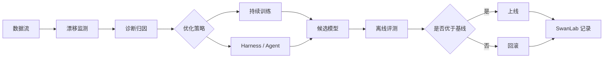

# 智训引擎：工业模型自进化系统

第二届北京市大学生“人工智能+”创新大赛“智训引擎”赛题项目。

本项目面向数据持续变化的工业场景，目标是在没有人工干预的情况下完成：

```text
漂移监测 -> 诊断归因 -> 实验优化 -> 评估上线 -> 失败回滚
```

系统既支持对工业模型进行持续训练，也支持通过大模型智能体与 Harness
自动选择优化策略。每轮训练和评估都会生成本地 JSON 审计记录；需要在线
实验记录时再上传 SwanLab。

## 当前系统现状

更新时间：2026-11-27（全员问题修复，见 `docs/全员问题修复-1127.md`）。

| 部分 | 当前状态 | 说明 |
| --- | --- | --- |
| 官方 SDK | 已完成 | `contest_harness 1.0.5`，支持 `chunked-v1` 分块上传 |
| 成员 1：控制面 | 已完成 | `describe / train / predict`、数据适配、预算、状态、候选提交 |
| 成员 2：漂移诊断 | 已完成 | 指标退化、PSI/KS、工况和输入范围变化诊断 |
| 成员 3：模型决策 | 代码已完成 | 解析并严格校验 Qwen 动作与参数；平台真实调用尚待试运行 |
| 成员 4：工业模型训练 | 已完成 | 从平台父检查点续训，支持微调和近期窗口重训 |
| 成员 5：评测与门控 | 已完成 | 当前/候选模型对比、上线或保留、轮次审计记录 |
| 本地验证 | 已通过 | `305 passed, 9 skipped`（镜像测试 9 项另跑） |
| Linux/amd64 镜像 | 本地已构建 | WSL 内构建并通过 describe/predict/离线只读/SIGTERM 验收；平台导入待试运行 |
| 平台正式评测 | 待进行 | 尚未执行真实 Qwen 调用、10 轮闭环和隐藏集评测 |

系统镜像默认使用 `configs/harness.full.json`，运行时链路为：

```text
/app/harness.py
→ contest_submission.train(rnd)
→ round_runner
→ member2 漂移诊断
→ member3 Qwen 决策与参数校验
→ member4 在预算内比较通用候选并逐 epoch 选优
   （全量/近期/可选历史回放）
→ member5 候选评测与上线门控
→（成员 2 给出 rollback_hint 时）曾上线的模型与本轮候选在验证集上比较
→ submit_candidate / save_state / finish
```

任何一步出现可恢复的异常时，`round_runner` 保留父模型、保证有一次模型调用并照常
`finish`（`final_action = failed`）；只有 SDK 的协议级错误（RPC 结果未知、流中断、
本轮已结束）和父检查点校验失败会直接抛出。调试时可设 `ZHIXUN_STRICT_ROUND=1` 关闭兜底。

本地 A 包集成轮已经跑通真实诊断、真实工业模型训练和真实验证门控：

```text
Macro-F1：0.7140 → 0.7257
候选模型：promote
Artifact：model-2
```

该轮使用测试宿主模拟 Qwen 返回决策 JSON，没有消耗平台额度；模型训练、评测、
候选上传和轮次记录都是实际执行的。它不是平台正式分数。

## 运行中涉及的工具

| 工具 | 作用 | 不是什么 |
| --- | --- | --- |
| Git / GitHub | 保存代码、配置和修改历史，方便多人协作与回滚 | 不负责训练模型 |
| `contest_harness` SDK | 平台与参赛镜像之间的协议适配层 | 不负责训练，也不提供官方分数 |
| PyTRiO / 平台模型网关 | 提供 Qwen 等大模型调用能力 | 不会自动决定训练策略 |
| SwanLab | 记录指标、参数、日志和实验链接 | 不负责训练或提供模型算力 |

工业模型的训练和推理在参赛容器内使用 CPU 完成；Qwen 决策通过平台模型网关
调用。每轮还会保存本地 JSON 审计记录，SwanLab 在线记录由环境变量控制。

## 训练与策略优化边界

系统里有三个容易混淆的对象：

| 对象 | 是否需要训练 | 当前实现 |
| --- | --- | --- |
| 工业模型 | 必须 | 成员 4 从平台父检查点续训，生成新候选 |
| Harness 决策策略 | 必须实验优化 | 调整漂移阈值、提示词、动作规则、参数范围和上线门槛 |
| Qwen 权重 | 默认不训练 | 直接调用平台 Qwen；是否进一步微调由实验结果决定 |

每轮策略环路为：

```text
当前工业模型
→ 成员 2 判断是否退化以及原因
→ Qwen 根据诊断、历史和预算选择动作
→ 成员 4 训练工业模型候选
→ 成员 5 比较父模型和候选
→ 采纳、保留或拒绝
→ 结果写入状态，供下一轮使用
```

因此，代码完成不等于策略已经最优。接下来必须通过实验比较：

- 始终不更新、每次更新和只在漂移后更新；
- `finetune`、`retrain_full` 和 `retrain_recent`；
- 不同漂移阈值和上线门槛；
- 固定规则与 Qwen 决策；
- 不同训练轮数、近期窗口、学习率、批大小、类别平衡/低 RUL 加权、SWA、
  父模型 anchor 和特征增强。

评价策略时不只看 Macro-F1 或 RMSE，还要看 CPU、Token、更新次数、最差批次、
回滚能力和失败原因。Qwen 权重训练属于后续增强项，不应优先于完整平台实验。

## 开源策略与工具来源

本项目**不引入会替代官方 baseline 的新模型**；只借鉴开源训练策略、验证方法和
调参工具。官方 `contest.cpu-mlp.v1` 的任务、特征路径和类别始终不变。组委会确认：
不允许用全套数据从头训练另一套模型替代 baseline，但续训过程中的权重随机初始化，
以及从父模型迁移保留权重的结构化剪枝是允许的。

| 来源 | 用途 | 边界 |
| --- | --- | --- |
| **Optuna** | 学习率、epoch、窗口、batch、权重、SWA/anchor 开关的本地 HPO | 只在本地调参，镜像不依赖 |
| **scikit-learn** `GroupKFold` / `TimeSeriesSplit` | B/C 按轴承/unit、A 按 batch 的分组/时间验证 | 只用于验证和选型，不把验证集并入梯度训练 |
| **Avalanche / continual-learning**（EWC/replay/LwF） | 小新数据增量更新的思路；本实现用父模型 anchor（EWC-lite）+ replay | 库是 PyTorch；只借算法，不引入模型 |
| **torch.optim.swa_utils** 的 SWA 思路 | 逐 epoch 权重平均，输出仍是单个 checkpoint | NumPy 实现，架构不变 |
| **tsaug / 时间序列增强** | 对训练特征做 jitter/scale 增强 | 只扩训练行，不改输入 schema |
| **C-MAPSS / XJTU-SY RUL 仓库** | 验证切分、NASA 非对称评分、RUL 误差分析 | 不搬 CNN/LSTM/Transformer 模型 |
| **NASA PCoE scoring** | C 的 NASA 非对称评分和低 RUL 加权参考 | 只作报告/权重参考 |
| **官方 contest_harness 1.0.5** | 协议、父检查点、状态和候选上传 | 版本固定 |

开源模型（LSTM/CNN/Transformer、RandomForest/GBDT、集成模型）会改变模型结构
或 checkpoint 格式，本项目**不直接使用**；只采纳它们的训练/验证策略。

已实现的训练策略（全部从父模型续训）：

- 结构化剪枝：从父模型迁移保留权重、Adam 状态和归一化统计，meta 记录 `migration`；作为候选由验证集决定是否采用；
- 低学习率/批大小、全量/全局尾部/按组窗口候选；
- A 的类别平衡加权；B/C 的低 RUL 加权（分组平衡权重可用，但本地对照实验更差，默认不启用）；
- SWA 权重平均、父模型 anchor（EWC-lite）、replay；
- 特征 jitter/scale 增强；
- 平台没有 `meta` 时从 `id` 回退解析 bearing/unit/batch，用于分组验证和最差组审计；
- 每个候选都记录最差绝对组及其相对父模型的变化（平台 worst 指标口径），并对最差组退化施加选择惩罚（0.5）；回归任务同时按成员5口径计算最差 256 行批次，选择分数加 0.2×最差批次改善；分组指标用 `np.bincount` 向量化，父模型验证预测每轮只算一次；
- C 按成员4同口径计算 NASA 非对称分数（`exp(-d/13)-1` / `exp(d/10)-1`，指数裁剪到 ±50 后取**平均**），作为辅助指标参与门控（默认相对容差 2%），并写入轮次记录和 SwanLab；成员4 在逐 epoch/跨计划选择时也优先 gate-safe 候选；
- C 的候选上限改为 8 epoch（验证曲线非单调：epoch 2 为 52.22，epoch 8 为 51.78），按“gate-safe 优先、再按 RMSE”选择，可用当前训练投影重拟合输入标准化；
- 训练行身份沿用集成分支的定长 Bloom 过滤器，保存在 `rows.json`；
- SwanLab 通过本地可选依赖安装，平台运行后由本地脚本补记实验；
- 小新数据节奏：`<0.5%` no_update，`0.5%–5%` 1×1 + replay/anchor，`>5%` 或明显退化完整搜索。
- 稳定轮探测：连续 3 轮 no_update 后给一次 1×1 探测；B 用最近 10% 尾部 1 epoch（实测 461.75→458.56），C 用 recent-selected 1 epoch，避免第 2–10 轮完全沿用第一轮模型。

第 1 轮本地对照（平台行、无 `meta`）：B 的剪枝候选（24→8 隐藏单元，最近 50%，
5 epoch）把平均 RMSE 从 `681.16` 降到 `459.76`，最差批次从 `1064.97` 降到
`692.93`；C 的剪枝候选（32→24）得到 `52.24 / 153.83`，但平均不如权重-only
的 `recent-selected`（`51.83 / 157.21`）。按组窗口 + 分组平衡权重在 B/C 都更差，
因此不进默认组合。

## 开发环境基线

- Python：官方要求 3.10 及以上；团队正式开发时建议统一锁定 Python 3.12
- 项目管理：Git + 私有 GitHub 仓库
- 代码编辑器：Visual Studio Code
- 实验记录：SwanLab
- Qwen 访问：平台模型网关；PyTRiO SDK 作为可选账户和调试工具
- 支持 macOS、Windows 原生环境和 Windows + WSL2 开发
- 不要求成员本地拥有 NVIDIA GPU

官方说明基础任务可以使用普通 CPU，并可能提供预提取特征。是否需要在本地
使用深度学习框架，以官方数据包的依赖说明为准。

## Windows 兼容性

工业模型使用 NumPy 在参赛容器内运行，不需要 NVIDIA GPU。Qwen 由平台模型
网关调用，Python 业务代码本身也没有 CUDA 依赖。

需要保证兼容的是 Windows 成员本地运行的部分：

- PyTRiO 和 SwanLab 的 Python SDK
- 数据读取与特征处理
- Harness 状态机与工具调用
- 单元测试、日志处理和文件读写
- 最终提交的系统镜像与运行入口

### 推荐方案：Windows + WSL2

可选的团队统一方案是让 Windows 成员使用 WSL2 和 Ubuntu。它便于统一
shell、文件路径和 Python 行为，也方便后续使用容器工具。该方案是我们的
开发建议，不是官方公布的评测要求。

在管理员 PowerShell 中安装 WSL：

```powershell
wsl --install -d Ubuntu
```

安装完成并重启后，从开始菜单打开 Ubuntu，然后执行：

```bash
sudo apt update
sudo apt install -y python3 python3-venv python3-pip git
```

建议把代码放在 WSL 的 Linux 文件系统中，例如：

```text
~/projects/zhixun-engine
```

不要把项目放在 `/mnt/c` 下进行大量训练和文件读写，否则可能明显变慢。

在 VS Code 中安装 **WSL** 扩展，执行 `WSL: Connect to WSL`，再打开 Linux
文件系统中的项目。

### 备选方案：Windows 原生环境

如果暂时不安装 WSL，也可以直接在 Windows PowerShell 中开发。先打开
PowerShell，进入项目目录：

```powershell
cd zhixun-engine
py -3.12 -m venv .venv
.\.venv\Scripts\Activate.ps1
python -m pip install --upgrade pip setuptools wheel
```

确认解释器：

```powershell
python --version
where.exe python
```

路径中应包含 `.venv\Scripts\python.exe`。在 VS Code 中选择：

```text
.venv\Scripts\python.exe
```

如果 PowerShell 不允许激活脚本，可以只对当前终端临时放行：

```powershell
Set-ExecutionPolicy -Scope Process -ExecutionPolicy Bypass
```

Windows 原生环境可以运行 Python 测试和调用平台模型网关。正式 Docker 镜像
必须按平台要求构建为 Linux/amd64；Windows 成员建议通过 WSL2 或 Linux 构建机
完成镜像验收。

### 跨平台开发规则

为了避免 macOS、Windows 和 Linux 之间出现隐藏差异，所有成员必须遵守：

- Python 路径使用 `pathlib.Path`，不要写死 `/` 或 `\`。
- 核心入口使用 Python 模块或跨平台 CLI，不要把业务逻辑只写在 shell 脚本中。
- 不依赖 `source`、`bash`、`chmod`、符号链接或 POSIX 信号实现核心功能。
- 文件名区分大小写，不使用 Windows 专属字符。
- 文本文件统一使用 UTF-8；Git 统一管理换行符。
- 第三方依赖必须写入项目依赖文件并锁定版本。
- 提交前由至少一名不同操作系统的成员运行测试，或者统一在相同的容器中
  运行测试。
- 最终运行结果以组委会评测环境和官方基础镜像为准，不以某位成员的电脑
  或未经确认的本地环境为准。

## 系统架构



## 目录结构

```text
.
├── zhixun_harness/        # 成员 1 控制面（契约、校验、编排、store）
│   ├── contracts.py       # 成员间数据契约
│   ├── codec.py           # JSONL 读取、校验、StageBundle
│   ├── hashing.py         # source / canonical 哈希
│   ├── sources.py         # 本地 manifest 与 workspace.v2 适配
│   ├── store.py           # 原子 artifact 事务与 active-model
│   ├── budget.py          # 预算与熔断
│   ├── pipeline.py        # 成员 2–5 接口
│   ├── fakes.py           # 假实现（不可得分）
│   ├── orchestrator.py    # 本地两阶段主循环
│   ├── round_runner.py    # 官方一轮 train(rnd) 适配
│   └── platform.py        # 平台适配器导出
├── member2/               # 漂移诊断、信号和固定规则兜底
├── member3/               # Qwen 决策、回复解析和严格参数校验
├── member4/               # 工业模型续训和候选生成
├── member5/               # 候选评测、上线门控和实验记录
├── app/harness.py         # 官方入口，复制为 /app/harness.py
├── contest_submission.py  # 官方选手模块 train / predict
├── configs/
│   ├── harness.full.json  # 正式全系统配置
│   ├── harness.member*.json # 各模块独立调试配置
│   └── dev/               # 本地开发覆盖配置
├── scripts/               # 启动、验证、打包脚本
├── tests/                 # 单元测试、协议测试与夹具
├── docs/                  # 接口契约、参考实现与规格
├── contest-harness-sdk-1.0.5.tar.gz  # 官方 SDK 归档
├── data/                  # 官方数据，不提交到 Git
├── Dockerfile
└── pyproject.toml
```

模型权重、checkpoint、实验输出、`artifacts/` 和虚拟环境不进入 Git 仓库。

## 快速开始

### 1. 获取代码

仓库建立 GitHub 远程地址后，团队成员使用：

```bash
git clone https://github.com/gkdzjc/zhixun-engine.git
cd zhixun-engine
```

### 2. 创建虚拟环境

macOS、Linux 或 WSL：

```bash
python3 -m venv .venv
source .venv/bin/activate
python -m pip install --upgrade pip setuptools wheel
```

确认当前使用的是项目环境：

```bash
which python
python --version
```

路径中应该包含 `zhixun-engine/.venv`。

Windows PowerShell 原生环境：

```powershell
py -3.12 -m venv .venv
.\.venv\Scripts\Activate.ps1
python -m pip install --upgrade pip setuptools wheel
python --version
where.exe python
```

路径中应该包含 `.venv\Scripts\python.exe`。

### 3. 安装项目与官方 SDK

```bash
python -m pip install -e ".[dev]"
python -m pip install ./contest-harness-sdk-1.0.5.tar.gz
```

本地单元测试不需要先登录 PyTRiO 或 SwanLab，也不会访问隐藏数据。

### 4. 运行全部测试

```bash
python -m pytest -q
```

当前基线应为：

```text
305 passed, 9 skipped
```

只运行全系统接口和 A 包真实训练链路：

```bash
python -m pytest -q tests/test_full_system.py
```

该测试会组合成员 2–5，使用官方 A 包父检查点训练 1 个 epoch，比较父模型和
候选模型，并验证候选被门控接纳。Qwen 回复由测试宿主模拟，不消耗额度。

安装可选的真实 Qwen 依赖，并显式运行本地实测：

```bash
python -m pip install -e ".[live]"
trio login
python scripts/run_live_qwen_e2e.py --datasets B --rounds 10 --max-tokens 512
```

该脚本只有在本地已登录 PyTRIO 时才会调用真实
`Qwen/Qwen3.8-27B`，不会写入API Key，也不会进入默认pytest。详细证据和限制
见`docs/live-qwen-local-verification-20261126.md`。

### 5. 检查官方镜像入口

macOS、Linux 或 WSL：

```bash
CONTEST_CONFIG=configs/harness.full.json PYTHONPATH=. \
  python app/harness.py describe
```

Windows PowerShell：

```powershell
$env:CONTEST_CONFIG = "configs/harness.full.json"
$env:PYTHONPATH = "."
python app/harness.py describe
```

应输出：

```json
{"protocol":"contest.harness.workspace.v2","model_access":"host_gateway_rpc","sdk":"contest_harness","sdk_version":"1.0.5","tasks":["classification","regression"]}
```

`train` 不能直接在空终端启动；平台必须通过 stdin 注入本轮 `start` 帧。

### 6. 可选：连接实验平台

只有需要在线实验记录或测试个人模型账号时才执行：

```bash
python -m pip install swanlab pytrio
swanlab login
swanlab verify
trio login
```

API Key 只能保存在平台密钥栏或本地环境变量中，禁止提交、截图或发送给他人。
平台镜像离线运行。本地安装 SwanLab 后，可用 `scripts/upload_platform_runs.py` 补记实验。

## 团队协作

### 五人建议分工

| 角色 | 主要职责 |
| --- | --- |
| 队长 / 架构 | 赛题对接、进度管理、接口设计、代码审查和最终材料 |
| 数据 / 漂移 | 数据校验、漂移监测、漂移指标和归因分析 |
| 模型 / 优化 | 静态基线、持续训练、调参和候选模型管理 |
| Harness / 工程 | 自动闭环、PyTRiO 接入、日志、状态机和容器化 |
| 评测 / 实验 | 指标复现、SwanLab 规范、成本统计、对照实验和报告 |

每位成员应有明确主责，同时也应了解另一项工作的基本流程，避免关键工作只由
一人掌握。

### 日常开发流程

开始工作前先同步远程代码：

```bash
git pull --rebase
```

每次修改使用独立分支：

```bash
git switch -c feature/<简短功能名>
```

提交前检查：

```bash
git status
git diff
```

提交并推送：

```bash
git add <本次修改的文件>
git commit -m "<清楚的提交说明>"
git push -u origin HEAD
```

团队成员通过 Pull Request 审查后合并到 `main`。不要把一个成员的全部修改未经
检查直接合并。

## 实验规范

实验不是简单地把训练脚本运行一次，而是对一个明确假设做受控验证：

```text
提出假设 -> 只改变一个变量 -> 固定其他条件
-> 运行实验 -> 使用统一指标评测 -> 记录结论
```

例如：

```text
假设：检测到漂移后，使用最近 30% 的数据重训，
比继续使用静态模型效果更好。

对照组：静态模型，不更新。
实验组：使用最近 30% 的数据重训。
其他条件：数据版本、特征、模型结构、评测脚本和随机种子保持不变。
```

每次结果都要同时考虑效果和成本。比赛既关注模型是否提升，也关注单位增益消耗
了多少 GPU 时间、训练额度、Token 或标注预算。

### 无官方数据时的预实验

在官方数据发布前，可以生成一份带时间顺序的合成分类数据，用来验证完整闭环：

```text
正常数据 -> 静态基线 -> 人为引入漂移
-> 漂移报警 -> 重训候选模型
-> 评测 -> 上线或回滚
```

建议至少比较以下三组：

| 实验 | 更新方式 | 目的 |
| --- | --- | --- |
| 对照组 | 始终不更新 | 检查模型漂移后的性能下降 |
| 实验一 | 每隔固定数量样本重训 | 验证周期更新 |
| 实验二 | 漂移指标超过阈值后重训 | 验证按需更新 |

合成实验必须标记为 `synthetic`，不能把合成数据结果当成官方赛题成绩。预实验
应同时验证失败路径，例如数据为空、字段缺失、训练超时、评测分数低于基线、
候选权重损坏和达到最大迭代次数。

### 官方数据到位后的实验顺序

1. 使用官方训练集、验证集和评测脚本复现静态基线。
2. 保存基线分数、数据版本、随机种子和资源消耗。
3. 建立统一样本流接口，确保不会把未来数据泄漏到当前预测。
4. 实现漂移监测，只调整一两个阈值进行对照实验。
5. 比较持续微调、重训和 Harness 策略优化。
6. 加入候选模型评估、上线门槛和自动回滚。
7. 在资源预算内做消融实验和稳定性实验。
8. 按官方规范在离线环境中验证完整闭环。

不能访问或猜测隐藏测试流，也不能使用隐藏测试结果反向调整模型。

### 一次实验的步骤

1. 指定一名实验负责人和一名复核人。
2. 创建实验分支，例如：

```bash
git switch -c experiment/ex-001-drift-threshold
```

3. 在 `configs/` 中保存本次实验配置。
4. 写清楚假设、对照组、唯一改变的变量和停止条件。
5. 固定数据版本、代码提交、模型、评测脚本和随机种子。
6. 在 SwanLab 创建同名实验并开始记录。
7. 运行训练或评估，记录指标、日志、资源消耗和失败信息。
8. 与静态基线和当前最佳模型比较。
9. 把结论写进提交说明和 Pull Request。
10. 复核人检查配置和结果后决定合并、继续实验或回滚。

实验名称建议包含实验编号、日期和关键变量：

```text
EX-000_20261106_baseline-synthetic
EX-001_20261107_drift-threshold-005
EX-002_20261107_drift-threshold-010
EX-003_20261108_update-recent30
EX-004_20261108_failed-update-rollback
```

### SwanLab 记录要求

真实训练或评估代码应使用统一的项目名，并把本次实验配置写入 `config`：

```python
import swanlab

swanlab.init(
    project="zhixun-engine",
    name="EX-001_20261107_drift-threshold-005",
    config={
        "experiment_id": "EX-001",
        "git_commit": "<提交编号>",
        "data_version": "<数据版本或哈希>",
        "model": "<模型名称或版本>",
        "changed_variable": "drift_threshold",
        "threshold": 0.05,
        "seed": 42,
    },
)

for step in range(total_steps):
    train_loss = train_one_step()
    metrics = evaluate_current_model()

    swanlab.log(
        {
            "train/loss": train_loss,
            "validation/score": metrics["score"],
            "cost/cpu_seconds": metrics["cpu_seconds"],
            "cost/gpu_seconds": metrics["gpu_seconds"],
            "cost/tokens": metrics["tokens"],
        },
        step=step,
    )

swanlab.finish()
```

上面的 `train_one_step()` 和 `evaluate_current_model()` 只是接口示意，需要根据
官方数据和评测 SDK 实现。工业模型的训练和推理在本项目中由 NumPy CPU 执行；
如果额外使用 PyTRiO，它只承担其他大模型训练或推理任务，不替代工业模型训练。

每次实验至少记录以下内容：

- 负责人和代码提交版本
- 实验假设、对照组和唯一改变的变量
- 数据版本或数据哈希
- 模型与 Adapter 路径
- 超参数和随机种子
- 准确性、稳定性等评测指标
- CPU/GPU 时间、Token 和标注成本
- SwanLab 实验链接
- 结论、失败原因和是否回滚

### 结果判断与验收

训练损失下降不等于比赛成绩提高，必须使用官方评测脚本或约定的统一评测器。
候选模型至少满足：

- 评测分数不低于静态基线。
- 在多个随机种子或稳定窗口中结果不出现明显退化。
- 单位增益所消耗的算力、Token 和标注预算在限制内。
- 新模型失败或超时时能够自动回滚到上一个稳定版本。
- 每轮都有本地 JSON 审计记录；需要在线验收时，SwanLab 状态为已提交。

如果候选模型没有超过当前最佳版本，应保留原有模型并记录失败原因。不要删除
失败实验记录，因为它们能说明技术路线选择和成本控制。

## 下一阶段团队行动计划

代码接口已经完成，接下来重点是镜像、真实平台调用和实验证据。建议按以下顺序：

### 第一步：合并后的基线验收

1. 所有成员从最新 `main` 创建自己的新工作分支。
2. 在空白虚拟环境重新执行安装和全部测试。
3. 确认 `git status` 没有密钥、数据、checkpoint、SwanLab 日志或训练输出。
4. 用同一个提交运行 `describe`，确认 SDK 版本和分类/回归任务声明一致。

### 第二步：生成 Linux/amd64 镜像

在一台有 Docker 的 Linux 或 WSL2 机器上：

```bash
bash scripts/build_image.sh zhixun-harness:0.1.0      # 把当前提交号写进镜像（--build-arg GIT_COMMIT）
bash scripts/verify_image.sh zhixun-harness:0.1.0     # 5 步验收，第 5 步跑 tests/test_image.py
docker save -o zhixun-harness-0.1.0.tar zhixun-harness:0.1.0
```

试运行镜像（第 3 轮强制验证一次回滚路径）用
`HARNESS_CONFIG=/app/configs/harness.trial.json bash scripts/build_image.sh zhixun-harness:trial`，
试运行要看的项目见 `docs/平台试运行清单.md`。

镜像应使用非 root 用户运行，只依赖镜像内文件；不要把本地 `.env`、API Key、
官方数据或训练产物打进镜像。上传文件必须是 `docker save` 生成的单个未压缩
Linux/amd64 tar，而不是源码 ZIP。

### 第三步：平台最小试运行

先不要直接做十轮实验。第一轮只验证接口：

1. 平台能启动镜像并完成 `describe`。
2. 每轮只发生一次真实 Qwen 调用，并返回有效 `call_id`。
3. 父检查点摘要校验通过。
4. 状态上传、预测逐行输出和轮次记录正常。
5. 即使选择 `no_update`，也必须提交真实模型调用回执和决策理由。

最小试运行通过后，再做一次真实 `finetune` 或 `retrain_full`，检查候选上传、
公开验证指标、门控结果、SwanLab 记录和下一轮父产物是否一致。

### 第四步：A、B、C 三类任务分别验收

每个数据包至少完成：

1. 官方静态父模型评分。
2. 不更新策略。
3. 一次真实续训策略。
4. 候选退化时保留父模型。
5. 后续批次继续使用平台选中的父产物。

不要根据 A 包的结论直接推定 B、C 也有相同收益；任务类型、指标方向和数据
维度都从本轮 `rnd.task` 读取，不能用数据包字母写死。

### 第五步：完成十轮闭环和证据

平台当前按数据集进行多轮优化。团队应至少完成：

- 三次“读取历史 → 实验 → 根据结果决定”的完整记录；
- A/B/C 各类任务的指标、成本和失败原因；
- 至少一个不更新、一个采纳、一个拒绝或回滚案例；
- 每轮对应的本地 JSON、SwanLab 记录和模型调用回执；
- 十轮结束后对平均指标、最差批次和累计成本的分析。

正式提交前保留足够试运行次数，不要反复提交尚未修复的同一镜像。

### 成员分工

| 责任 | 下一步 |
| --- | --- |
| 成员 1 / 队长 | Linux/amd64 镜像、`describe`、协议测试、平台试运行和最终集成 |
| 成员 2 | 标定 A/B/C 漂移阈值，整理每轮漂移证据和误报/漏报 |
| 成员 3 | 验证真实 Qwen 调用、提示词、回退策略和决策审计 |
| 成员 4 | 比较 `finetune`、近期窗口和全量续训，记录 F1/RMSE 与 CPU 成本 |
| 成员 5 | 统一门控、SwanLab、混淆矩阵、轮次对比和最终验收表 |

每完成一步都应通过 Pull Request 合并到 `main`，并在提交说明中写明实验编号、
代码版本、数据版本、指标和结论。

## 镜像上传与失败排查

> 发布人：平台管理员 · 发布时间：2026/11/13 20:01:26

看到“镜像处理未完成”时，请先查看该条镜像的状态。此提示可能表示处理失败，
不代表仍在后台排队；仅凭这句话不能判断具体原因。

### 一、正确生成上传文件

先完成镜像构建，再执行：

```bash
docker save -o harness.tar 你的镜像名:标签
```

例如：

```bash
docker save -o harness.tar my-harness:latest
```

请上传生成的 `harness.tar` 文件。不要上传源码 ZIP、项目目录压缩包、单独的
Dockerfile，或用 `docker export` 导出的容器文件系统包。把其他文件改名为
`.tar` 也不能变成镜像归档。

### 二、根据状态处理

- **上传中**：等待本次上传完成，不要重复点击上传。
- **等待导入／发布与核验中**：平台正在排队或处理，可刷新状态查看进度；上传
  完成后离开页面不会中断后台处理。长时间没有变化时请联系管理员。
- **镜像可用**：处理已完成，点击“用于新版本”，再继续保存提交。若列表里既有
  失败记录又有可用记录，请选择可用的那一份，历史失败记录不影响它。
- **发布未完成**：请联系管理员确认具体原因。若确认为“不是有效 Docker-save
  镜像归档”，请按上述命令重新导出并上传；反复导入同一个无效文件无法解决
  问题。若为平台服务或网络异常，按管理员指导重试，不必盲目重建镜像。
- **已过保留期**：原上传文件已清理，需要重新上传镜像归档。

### 三、注意区分

“上传完成”不等于“镜像可用”；“镜像可用”也不等于作品已通过模型校验、
续训协议验证或评测。已就绪镜像的临时上传归档被清理，不影响已发布镜像的
使用。

### 四、联系管理员时提供

队伍名、上传时间、文件名与大小、镜像状态及提示截图、导出时使用的命令。
不要发送 API Key、密码或其他访问凭据。

如平台确认你的提交不支持当前续训评测协议，请前往「基线模型」下载官方
baseline，基于其中的训练代码和初始检查点进行修改与续训。后续轮次须使用
平台提供的父检查点，并保留真实实验历史。

请勿从头训练新模型冒充续训，也不要仅更改模型文件后缀、附带未使用的父检查
点或补造数据元信息来通过校验。镜像应包含实际运行所需的代码和配置，并提供
独立预测入口；当前模型产物须符合 `checkpoint.npz` 交付约定。旧版 SDK
公告写的是 64 MiB；SDK 1.0.4 起改为分块上传，1.0.5 沿用，单候选/状态最多
64 个文件、合计 512 MiB，具体以本轮 `rnd.limits` 为准。

修正后请上传新镜像、保存新提交版本并重新发起试运行。请勿反复重跑尚未修复
的不兼容版本。

本提醒仅适用于已确认的续训协议不兼容。网络、计量服务或平台适配故障不代表
你的模型方案不支持；遇到此类问题请联系管理员核查，不必据此更换方案。已成功
完成评测的提交无需因本公告重新提交。

## 选手 Harness SDK 接入

> SDK 版本：`contest_harness 1.0.5` · 协议：`contest.harness.workspace.v2` ·
> 提示词版本：`industrial-workspace-flexible-v3`
> 本地资料：`contest-harness-sdk-1.0.5.tar.gz`（SDK 包，内含
> `HARNESS_SDK.md` 使用说明）

镜像只安装并携带SDK 1.0.5。设计文档中的1.0.2/1.0.4内容仅用于记录升级历史，
不是运行时依赖；仓库也不会保留1.0.2/1.0.4 Windows下载残留。SDK 1.0.5 会在
stderr 记录状态保存请求/回执和轮次提交/确认；镜像不要混装 1.0.4 或更早版本。

SDK 负责读取平台提示、公开数据和父模型，并让平台调用我们的镜像；评分、
隐藏标签和计量由平台负责。SDK 不包含分数，也不替选手设计训练算法。

系统镜像默认读取 `configs/harness.full.json`。它把成员二的漂移诊断、成员三的
Qwen 决策、成员四的工业模型续训和成员五的评测门控组合成一条完整流水线。
`harness.member2.json` 至 `harness.member5.json` 仅保留为各模块的调试配置。

### 提交里要有什么

1. **模型身份**：持久 Sampler 填写完整 `trio://` 路径；基础模型只填写平台
   白名单中的名称并完成二次确认。PyTRiO API Key 只填在平台密钥栏，不写入
   镜像、源码、文档或训练记录。
2. **训练与预测代码**：算法、续训方式和实验记录由选手自己决定。
3. **SDK**：镜像内安装本包，并把 `template/harness.py` 放到
   `/app/harness.py`。选手模块默认是 `/app/contest_submission.py`；使用其他
   模块名时设置环境变量 `CONTEST_SUBMISSION`。

固定入口：

```text
python3 /app/harness.py describe
python3 /app/harness.py train
python3 /app/harness.py predict
```

`describe` 向 stdout 打印一行 JSON，至少包含：

```json
{"protocol":"contest.harness.workspace.v2","model_access":"host_gateway_rpc","tasks":["classification","regression"]}
```

`tasks` 只能包含镜像实际支持的 `classification` 和 `regression`。`describe`
会导入选手模块并检查 `train`、`predict` 与任务声明；导入或检查失败、协议
字段不符合要求时，平台不会进入训练。通过 `describe` 不代表训练代码已经过
完整审查，也不保证训练成功。

### 目录与权限

| 路径 | 权限 | 内容 |
| --- | --- | --- |
| `/app` | 只读 | 选手代码、SDK、`/app/harness.py` |
| `/data/train.jsonl`、`/data/validation.jsonl` | 只读 | 当前阶段公开投影 |
| `/previous` | 只读 | 当前父产物，路径与清单一致 |
| `/state` | 只读 | 上一检查点保存的原生状态；首轮可能不存在 |
| `/model` | 只读 | 只在预测时挂载被选中的产物 |
| `/workspace` | 可写 | 本轮工作目录；候选、状态副本和临时工程放这里 |
| `/tmp` | 可写 | 临时文件；运行环境可能禁止在这里执行程序 |

不要在 `/app` 下创建目录或改文件，不要假设镜像根目录可写。

### 公开数据

训练和验证文件是 UTF-8 JSONL，空行跳过，每行是一个对象：

```json
{"id":"样本标识","inputs":{"特征":0},"answer":"标签或非负数值"}
```

`id` 是字符串，`inputs` 由当前数据集的冻结说明决定，`answer` 只出现在授权
的公开训练集和公开验证集。隐藏集不会挂进训练容器，也不能从文件名、样本号
或匿名标识反推。

`Round.data.training_rows()` 与 `validation_rows()` 按文件顺序逐行读取，不要
把整份数据一次性拼成另一份“官方包”。路径以 `rnd.task["public_projection"]`
为准，当前默认就是上面两个文件。需要 CSV 或其他布局时，在 `/workspace` 里
自行转换，并写明转换规则。

### 父模型

`rnd.parent.checkpoint_sha256` 是本轮必须续训的父检查点摘要。
`rnd.parent.path(相对路径)` 只打开清单里声明过的文件并核对摘要，路径形如
`checkpoint.npz` 或 `baselines/model.py`，来自父产物自己的 `checkpoint_paths`
和 `code_paths`。摘要不一致时 SDK 抛出 `PARENT_DIGEST_MISMATCH`。

不要搜索 `/app` 找权重，不要改 `/previous` 里的字节，也不要另造一份
`baseline-info.json` 去凑历史报告里的哈希。

### 一轮训练

`train(rnd)` 收到的 `rnd` 来自平台写入 stdin 的一帧 `start`，常用字段：

- `rnd.prompt`、`rnd.prompt_version`：本轮固定任务提示及其版本，只读。
- `rnd.dataset_key`：`A`、`B` 或 `C`。
- `rnd.round_index`：检查点序号，从 1 开始。
- `rnd.task`：冻结的任务类型、指标、方向、数据系列、目标单位和公开投影；
  任务类型以这里为准，不能把数据集代号当成 `classification`。
- `rnd.model_name`、`rnd.max_output_tokens`、`rnd.limits`：模型名、单次输出
  上限和候选/状态/元数据字节上限。

官方提示由宿主在请求发往模型前加到第一条 system 消息中，并附上本轮运行、
数据集、检查点和任务合同。`rnd.prompt` 可供代码读取，但不要再放进 system
或 user 消息，否则会重复；自己的 system 提示可以放第一条，宿主会加在它前面。

调用平台模型：

```python
receipt = rnd.model(
    [{"role": "user", "content": "这里只放本轮数据、代码状态和你自己的问题"}],
    max_tokens=1024,
    temperature=0,
)
```

省略 `max_tokens` 时使用本轮授权上限。`receipt.call_id` 是平台回执号，
`receipt.response` 是完整响应，`receipt.text` 是第一条文本回复。密钥、真实
端点和计费由平台持有，不要把 PyTRiO 密钥或外部采样客户端放进镜像。

已有 OpenAI 兼容客户端时，可以使用本地传输层：

```python
with rnd.transport() as transport:
    client = OpenAI(base_url=transport.base_url, api_key=transport.api_key)
    client.chat.completions.create(model=rnd.model_name, messages=messages, max_tokens=1024)
```

`transport.api_key` 只是本地占位符。传输层提供 `GET /v1/models` 和
`POST /v1/chat/completions`，支持工具调用、多个 choices 和
`stream_options.include_usage`；流式请求会先完成一次非流式平台调用，再把
完整回执转成事件流，不是实时 token 流。

`rnd.history()` 返回本数据集已完成的检查点记录，结束本轮时引用实际读过的
`id`；记录可以是空的。

候选从 `/workspace` 下的新目录提交，目录里只放普通文件。SDK 1.0.5 使用
`chunked-v1` 分块上传：单个候选或状态最多 64 个文件、合计 512 MiB；每轮
候选累计 1 GiB、状态累计 512 MiB，具体以 `rnd.limits` 为准。至少声明一个
检查点文件：

```python
submitted = rnd.submit_candidate(
    candidate_dir,
    hypothesis="本轮假设",
    change_summary="相对父模型实际改了什么",
    configuration={"epochs": 1},
    seed=1,
    checkpoint_paths=["checkpoint.npz"],
    code_paths=["baselines/model.py"],
    predict_argv=["python3", "/app/harness.py", "predict"],
)
```

`hypothesis` 与 `change_summary` 必须非空且各不超过 4000 字节；
`configuration` 是对象，序列化后不超过 64 KiB；`seed` 是整数。平台测量后
返回 `artifact_id` 和公开验证摘要，分数以返回值为准，不要另报一套。

本轮要留给下一轮的原生状态，先复制再写：

```python
state = rnd.state_workspace("/workspace/state")
# 只写 state 里面的文件
rnd.save_state(state)
```

`/state` 本身只读。不保存则沿用上一份状态；保存空目录表示清空。同一轮多次
保存时，每次都以本轮开始时的状态为父状态。

更早的产物可用 `rnd.restore_artifact(artifact_id, "/workspace/history/某id")`
取回，只能取本帧 `artifacts` 里出现过的标识，取回后核对摘要。

结束本轮：

```python
rnd.finish(
    selected_artifact_id=submitted["artifact_id"],
    hypothesis="本轮假设",
    change_summary="相对父模型实际改了什么",
    reason="根据本轮真实模型回复和平台测量做出的选择。",
    configuration={"epochs": 1},
    seed=1,
    history_ids=[item["id"] for item in history],
    model_call_ids=list(rnd.call_ids),
)
```

`model_call_ids` 不能为空，且必须是本轮 `rnd.model()` 或传输层实际返回的
调用号——每轮至少要有一次真实模型调用。调用 `finish` 并收到平台确认后进程
退出，确认前不要再发协议帧。stdout 只写协议 JSONL，日志写 stderr，不要在
训练进程里等待 stdin 结束才开始输出。

### 预测

平台按选中产物的 `predict_argv` 启动进程，只把该产物挂载到 `/model`。SDK
传给 `predict(sample, model_dir)` 的 `model_dir` 是 `/model` 根目录，不是
检查点文件；检查点路径见环境变量 `CONTEST_ARTIFACT_PATH`。平台还会设置
`CONTEST_ARTIFACT_MANIFEST`、`CONTEST_PREDICTION_CONTEXT`、
`CONTEST_DATASET_KEY` 和 `CONTEST_TASK`。

官方预测入口必须同时拿到 `CONTEST_CONFIG` 和 `CONTEST_ARTIFACT_PATH`。
缺少任一变量、artifact 不在 `/model` 内或不是普通文件时都会明确失败；不会再
回退寻找 `/model/checkpoint.npz`，也不会退化为假预测器。

预测没有 start 帧，stdin 第一行就是样本：

```json
{"task":"classification","inputs":{"特征":0}}
{"task":"regression","inputs":{"特征":0}}
```

`task` 是冻结合同里的 `classification` 或 `regression`，不是数据集代号。
必须逐行输出并刷新，不能等 EOF；分类输出：

```json
{"outputs":[{"label":"normal","score":1}]}
```

`label` 非空且不重复，`score` 是 0 到 1 的有限数，最高分只能有一个。回归
输出：

```json
{"outputs":{"value":0}}
```

`value` 是有限的非负数。缺行、等待 EOF、超时或形状不对，整次测量失败，平台
不会补预测值。

```python
def predict(sample, model_dir):
    # model_dir 是 /model 根目录；检查点路径见 CONTEST_ARTIFACT_PATH
    if sample.task == "regression":
        return {"value": 0}
    return [{"label": "normal", "score": 1}]
```

### SDK 包内容

| 路径 | 作用 |
| --- | --- |
| `contest_harness/protocol.py` | 协议常量、JSONL 收发、`isolate_stdio()` 隔离 stdout |
| `contest_harness/cli.py` | `describe` / `train` / `predict` 入口与错误上报 |
| `contest_harness/round.py` | `Round` 一轮训练的全部 RPC 和校验 |
| `contest_harness/transport.py` | 本地 OpenAI 兼容 HTTP 传输层 |
| `contest_harness/predict.py` | 逐行预测与输出形状校验 |
| `contest_harness/data.py` | 公开 JSONL 读取 |
| `contest_harness/errors.py` | 稳定错误码 `HarnessError` |
| `template/harness.py` | 复制到 `/app/harness.py` 的入口垫片 |
| `example/contest_submission.py` | 只验证协议的示例，不是可得分方案 |
| `example/pi_submission.py` | 通过 SDK 传输调用精简 pi 的示例 |
| `example/Dockerfile` | 镜像示例（需要另备 `example/pi.mjs`） |
| `tests/` | 离线协议测试与可选真实模型测试 |

### 本地检查

在 SDK 目录运行离线测试：

```bash
python3 -m unittest tests.test_sdk tests.test_contract_regressions tests.test_transport_regressions -v
```

这些测试使用 JSONL 宿主替身，不会调用真实模型。`tests/test_live.py` 需要
`PYTRIO_API_KEY`，可能产生费用；设置 `CONTEST_PI` 指向精简 pi 的 `pi.mjs`
时还可通过 SDK 传输层运行握手。单元测试通过不代表比赛中能得到实际分数。

## 成员 1 Harness 控制面

成员 1 负责数据入口、统一契约、主循环、artifact 管理和镜像交付。当前实现
位于 `zhixun_harness/`，官方入口由 `app/harness.py` 和
`contest_submission.py` 提供。

> 包名不叫 `harness`，因为镜像里的 `/app/harness.py` 会遮蔽同名包。

### 本地运行

安装开发依赖并运行测试：

```bash
python -m pip install -e . pytest
python -m pytest -q
```

从参考包生成两阶段夹具：

```bash
python scripts/build_stages_a.py \
  --package cpu-a-guide-20261110-v1 \
  --output tests/fixtures/stages_a \
  --limit 6
```

运行本地两阶段闭环（假 Pipeline）：

```bash
python -m zhixun_harness.orchestrator \
  --stage-root tests/fixtures/stages_a \
  --artifact-root /tmp/zhixun-artifacts \
  --run-id demo \
  --max-stages 2 \
  --initial-checkpoint cpu-a-guide-20261110-v1/checkpoint.npz \
  --config configs/harness.json
```

输出在 `artifact-root` 下：`active-model.json`、`runs/<run_id>/stage-*/`、
`manifest.json`、`bundle.json`、`diagnosis.json`、`decision.json`、
`evaluation.json`、`record.json`、`events.jsonl`。

### 官方协议入口

本地验证 `describe` 与 `predict`：

```bash
pip install contest-harness-sdk-1.0.5.tar.gz
PYTHONPATH=. python app/harness.py describe
printf '%s\n' '{"task":"classification","inputs":{"x":1}}' \
  | PYTHONPATH=. python app/harness.py predict
```

`train` 由平台注入 `start` 帧，`tests/test_round_protocol.py` 用真实 SDK
协议跑通了这条链路。正式运行时平台持有父检查点、状态和评分，我们只通过
`submit_candidate`、`save_state`、`finish` 交回结果。

### 构建镜像

```bash
docker build --platform linux/amd64 -t zhixun-harness:0.1.0 .
docker run --rm zhixun-harness:0.1.0 describe
```

镜像内含官方 SDK、本包和 `contest_submission.py`，以非 root 用户运行，
入口为 `python3 /app/harness.py`，并默认设置
`CONTEST_CONFIG=/app/configs/harness.full.json`。

### 假实现与真实实现的边界

`fakes.py` 中的诊断、决策、训练和评测都是**协议占位**：

- 假诊断返回固定漂移结论；
- 假决策每轮调用一次平台模型，但选择逻辑是固定的；
- 假训练把父检查点哈希包装成候选，不训练模型；
- 假评测返回常数指标；
- 假预测返回合法但无意义的输出。

它们只用于验证控制面，不代表分数。正式的 `configs/harness.full.json`
已经注册成员 2–5 的真实实现，不会加载这些假实现。

## 安全与合规

- 不把官方隐藏测试集、API Key 或账号密码提交到 GitHub。
- 不访问未授权的外部网络资源。
- 不攻击或绕过评测平台。
- 为自动迭代设置最大轮数、超时、Token、算力和标注预算。
- 任何候选模型上线前必须经过评测；未通过门槛时自动回滚。
- 引用开源代码和模型时遵守对应许可证。

## 当前限制

- 本地已在 WSL 构建并验收 Linux/amd64 镜像；尚未上传平台导入，也未在正式评测环境试运行。
- 本地测试使用模拟宿主返回 Qwen 决策；真实平台模型调用和回执尚未验收。
- 隐藏集、正式评分细节和 10 轮稳定性仍以测评平台为准。
- 镜像须用 `docker save` 导出为单个未压缩 Linux/amd64 tar。模型产物须符合
  `checkpoint.npz` 交付约定；SDK 1.0.5 的分块上传上限以 `rnd.limits` 为准。
- 正式评测沙箱约 2 CPU、4 GiB 内存；完整试运行按 SDK 1.0.5 文档为按需磁盘
  沙箱（16 核最多 4 Pod / 8 核最多 6 Pod，32 GiB 内存，`/workspace` 22 GiB）。
  成员 4 的成本估算需分别用真实运行数据标定。
- SwanLab 在线上传需要本地或平台密钥；没有配置时只写本地 JSON，不应把本地
  记录冒充为已上传的在线实验。

## 相关平台

- [SwanLab](https://swanlab.cn/)
- [PyTRiO](https://pytrio.com/)
- [PyTRiO 文档](https://docs.pytrio.com/)

## 成员5分支整合说明

成员5分支已整合 xhc 的结构化剪枝、最差组/批次候选选择、C 题全量最多8个epoch和少量新数据训练节奏。
稳定且无新数据时继续采用有界探测，每4轮允许1候选、1epoch，CPU至少剩余25%，连续2次实际探测未提升后冷却8轮。
执行层校验探测资格、训练规模和父模型seed，退化与新增数据优先使用对应训练策略。
行状态使用紧凑的 rows.npz，兼容历史 rows.json 和成员5的 Bloom 状态。Windows 原子写入保留有界重试。
